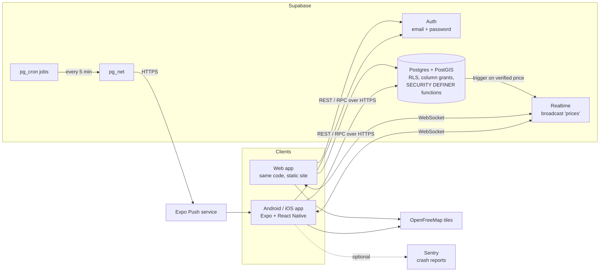
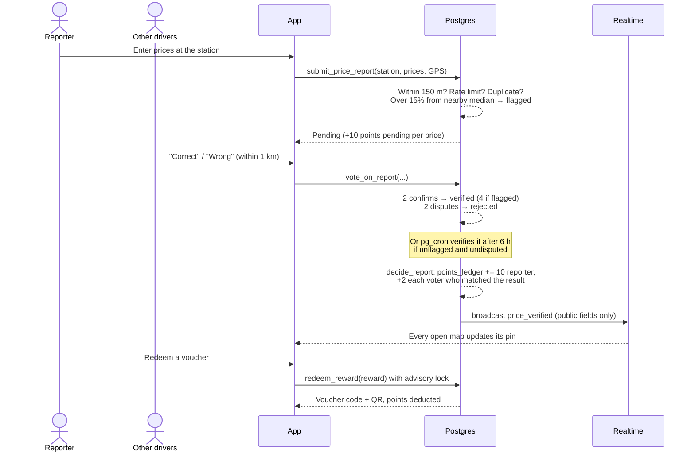

# FuelWards architecture

FuelWards is one TypeScript codebase that runs on Android, iOS and the web. All business rules live in the database, so every client gets the same checks.

## System overview



| Piece              | Where it runs                            | Notes                                                                                      |
| ------------------ | ---------------------------------------- | ------------------------------------------------------------------------------------------ |
| App                | Phones (EAS Build APK/AAB), web (Vercel) | Expo SDK 58, Expo Router, NativeWind, TanStack Query, MapLibre                             |
| Updates            | EAS Update                               | JavaScript fixes reach installed apps without a reinstall (`npm run update:preview`)       |
| Database and API   | Supabase (free plan)                     | Postgres 17 with PostGIS; PostgREST exposes tables and functions                           |
| Background jobs    | `pg_cron` inside Postgres                | Auto-verify quiet prices (15 min), send pushes (5 min), erase old report locations (daily) |
| Push notifications | `pg_net` → Expo Push API                 | No separate server or Edge Function needed                                                 |
| Station data       | OpenStreetMap (Overpass API)             | 1,450 Metro Manila stations, imported by `scripts/import-osm-stations.ts`                  |

## The core loop: report → confirm → points → reward



Every rule value (distances, thresholds, points, tiers) lives in the `app_config` table, so it can be changed without a release.

## Security model

- **Row-Level Security on every table.** Clients can only read their own private rows: points, votes, vouchers, alerts and settings.
- **Column grants.** Other users can see a report's price and status, never who sent it or from where. Profiles expose only the username and display name.
- **No direct writes to anything that matters.** Reports, votes, points, redemptions, bans and announcements go through `SECURITY DEFINER` functions. Each function checks the caller (`auth.uid()`, `is_admin()`) and the rules in one transaction.
- **Bans are triggers.** A `BEFORE INSERT` trigger on reports, votes, alerts and redemptions blocks banned users, whatever path the insert takes.
- **Admin accountability.** Admin functions, and direct admin edits to stations, rewards, bulletins and settings, are written to `admin_actions`. Clients can't modify that table.
- **Keys.** The app ships only the publishable key. The secret key is never in the app or the repo.

## Privacy (RA 10173)

| Data                              | Kept                            | How it ends                                              |
| --------------------------------- | ------------------------------- | -------------------------------------------------------- |
| Report location                   | 12 months                       | Daily job `purge_old_report_locations`                   |
| Account, points, vouchers, alerts | While the account exists        | Profile → Delete my account                              |
| Confirmed prices                  | Permanently, as station history | The reporter link is removed when the account is deleted |
| Crash reports                     | Sentry's retention              | Never include IP, location or account details            |

Users can download everything held about them as JSON (`my_data_export`). Sign-up records consent, and any account created another way is asked for consent before the app opens.

## Client architecture

```
src/
  app/            Expo Router screens: (auth)/ before login, (app)/ after, (app)/admin/ for admins
  features/       One folder per feature: api.ts (queries/mutations), pure helpers (+ __tests__), UI parts
  components/     Shared UI (Button, TextField, Segmented, Toast…)
  i18n/           English and Filipino strings (type-checked to have the same keys)
  theme/          Colour tokens as CSS variables (light/dark), AA-contrast text colours
  lib/            Supabase client (typed from database.types.ts), query client, monitoring
```

- **Server state:** TanStack Query. Selected queries are saved to device storage for 24 hours, so the app works offline.
- **Live data:** one Realtime channel patches the cached station lists in place. A late-confirmed older report never overwrites a newer price.
- **Theme and language:** CSS-variable tokens and i18next. Both follow the phone, and the user can override them in Profile.

## Testing

| Level              | Tool                                                                | Runs                                                                                        |
| ------------------ | ------------------------------------------------------------------- | ------------------------------------------------------------------------------------------- |
| Database rules     | pgTAP (`supabase/tests/database`, 125 tests)                        | CI on a fresh local Supabase; on the hosted project in a transaction that always rolls back |
| Schema ↔ app types | App type-checked against types generated from the migrations        | CI                                                                                          |
| Pure logic         | Jest (`__tests__` folders)                                          | CI                                                                                          |
| Web flows          | Playwright (`e2e/web`) against the built web app and local Supabase | CI                                                                                          |
| Phone flows        | Maestro (`e2e/maestro`)                                             | By hand on a phone or emulator                                                              |
| Static checks      | TypeScript, ESLint, Prettier                                        | CI                                                                                          |
